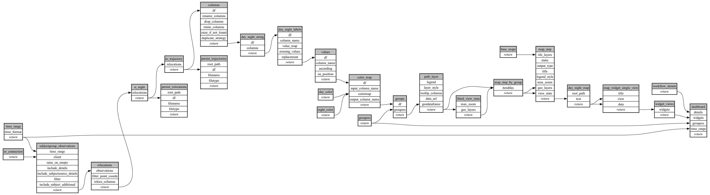

```
# AUTOGENERATED BY ECOSCOPE-WORKFLOWS; see fingerprint in README.md for details

```

```yaml
# fingerprint:
artifacts_sha256_basic: 1c7de4e0218f29702cec60fa880665fa7a22e1e4cad0e66f2cd6e9c3ab5fc018
artifacts_sha256_strict: d54e1d04019730548ab434d2fc1bcc3120ea32f30a5cb88fe658b8a113486d35
installed_requirements:
- channel: https://repo.prefix.dev/ecoscope-workflows/
  name: ecoscope-platform
  version: {version: ==2.25.3}
- channel: https://repo.prefix.dev/ecoscope-workflows-custom/
  name: ecoscope-workflows-ext-custom
  version: {version: ==0.1.4}
- channel: conda-forge
  name: pydeck
  version: {version: ==0.9.2}
params_sha256: b46c295b9564ba5ffa9ca25f0db56c765b4d1ef81d14ad950b9e603aafb1e8c9
spec_sha256: 661bbaf182a197c90df1da0c3012d7b2e8f2248b16b2180373061b6878f3717b

```

# ecoscope-workflows-subject-tracking-night-day-map-workflow


